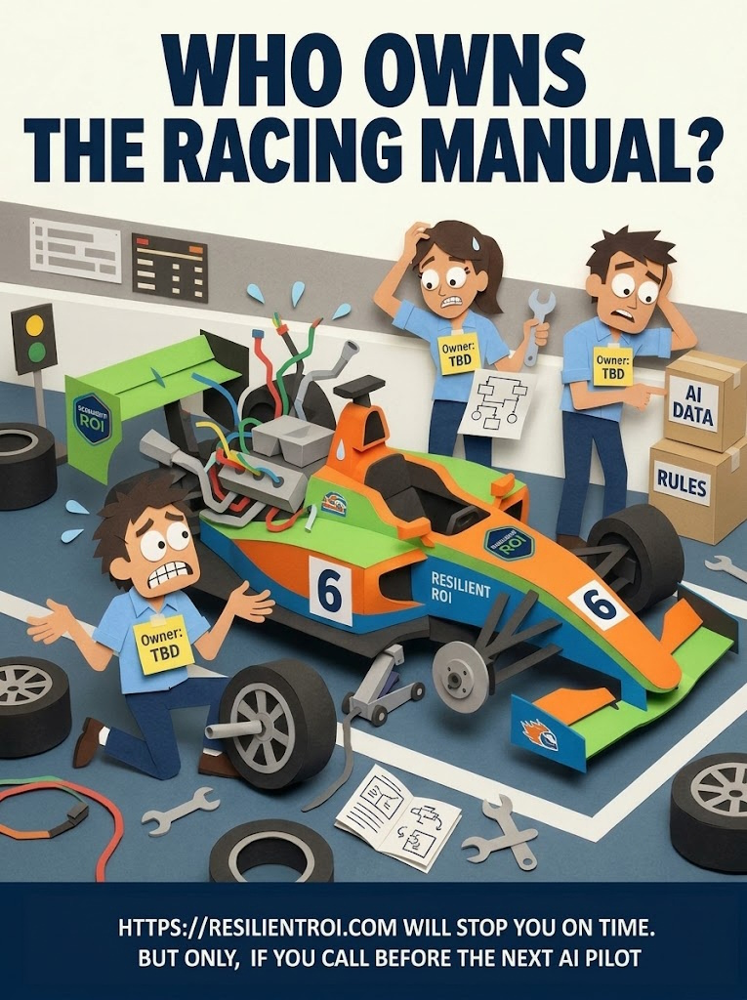
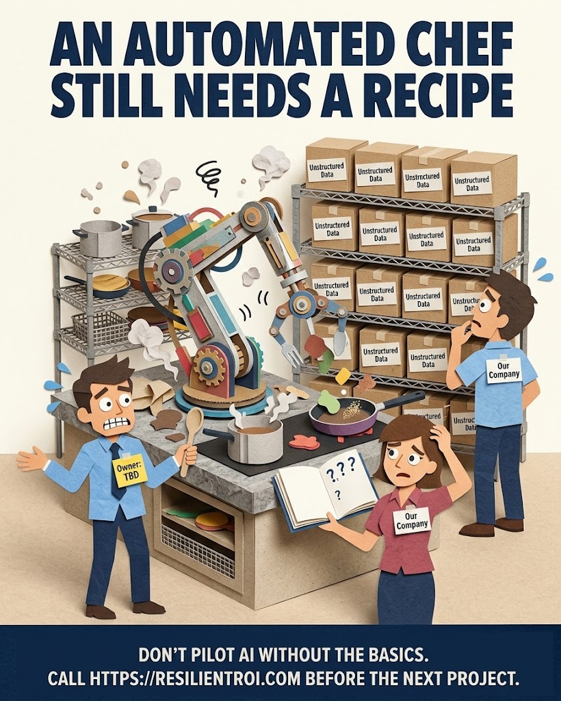
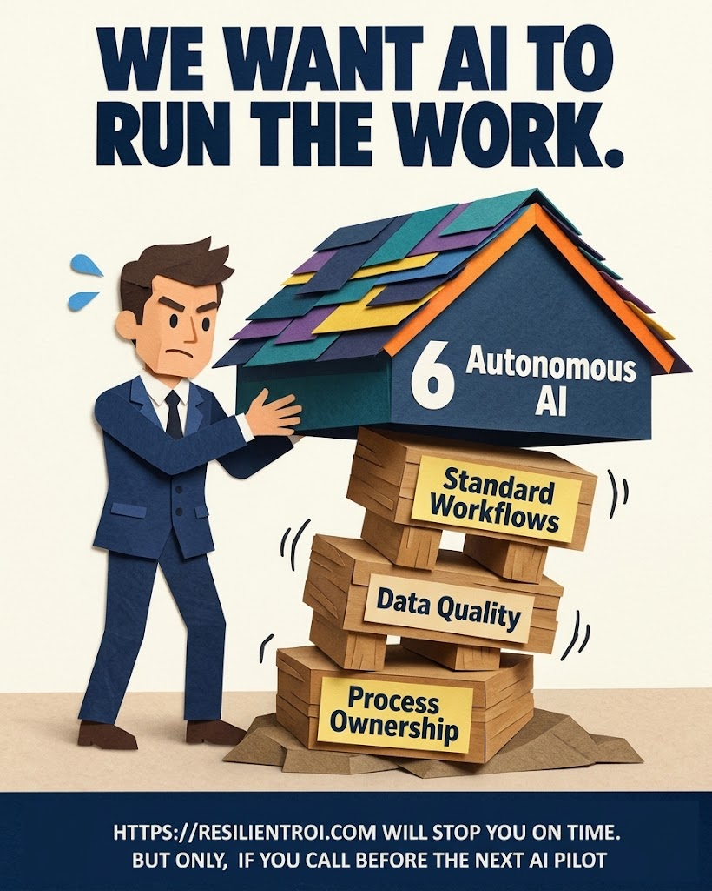
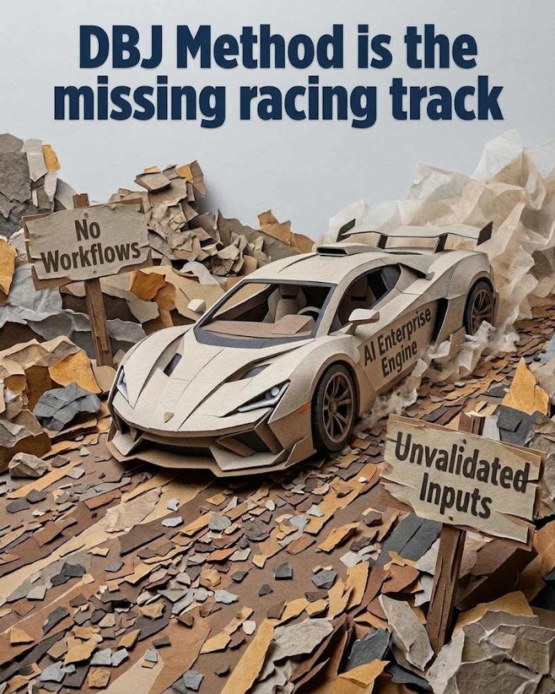

Buying the car is the easy part. Anyone can procure a BPT platform, an AI subscription, a roadmap deck with "agentic" on every third slide. Driving it without putting it in the wall on lap one is the part nobody budgets time for.

## Who Owns the Racing Manual?

AI  speed engine with no named driver is a liability sitting in the annual report, not an asset on the market. If "Owner" is still "TBD" when someone turns the key, the manual's first chapter was never opened. Operating method ownership isn't a detail to backfill slide set once the pilot is already running — it's the precondition for everything after it, per the [BPT Operating Model](https://method.dbj.org/bpt/bpt_operating_model/).

## An Automated Chef Still Needs a Human Made Recipe

Automation doesn't remove the need for a human concept — it raises the price of not having one. Feed an AI kitchen a wall of unlabelled "Unstructured Data" boxes and what comes out is expensive smoke. The question to ask before the pilot isn't "can the model do this," it's "do we have a recipe company can follow." If the answer is a shrug, that's the manual telling you to stop reading. Call us.

## We Want AI to Run the Work

Every pilot starts here: "we want AI to run the work." Fine — but autonomous AI is the roof, not the foundation. It sits on standard workflows, data quality, and process ownership, in that order. Pull one block out from under it because it looked like the slow part, and the roof doesn't float on good intentions. It comes down on whoever's standing closest to that AI demo.

## But How Will We Run the 'Engine'?

This is what driving without the racing track looks like at speed: a capable engine dropped onto terrain of company landscape nobody surveyed.  Seen in the shop window the car isn't the problem. It was never the problem. The lack of AI racing track nobody checked before hitting the throttle. The problem: you're on the gravel. Competition is on the fast lane.

## Somebody Forgot the Fast Lane Manual

It's the difference between arriving at AI speed and finding out, the hard way; what's waiting at the end needs the manual. Read the [BPT Operating Model](https://method.dbj.org/bpt/bpt_operating_model/) before the next AI pilot — not after it stays on the starting line,
