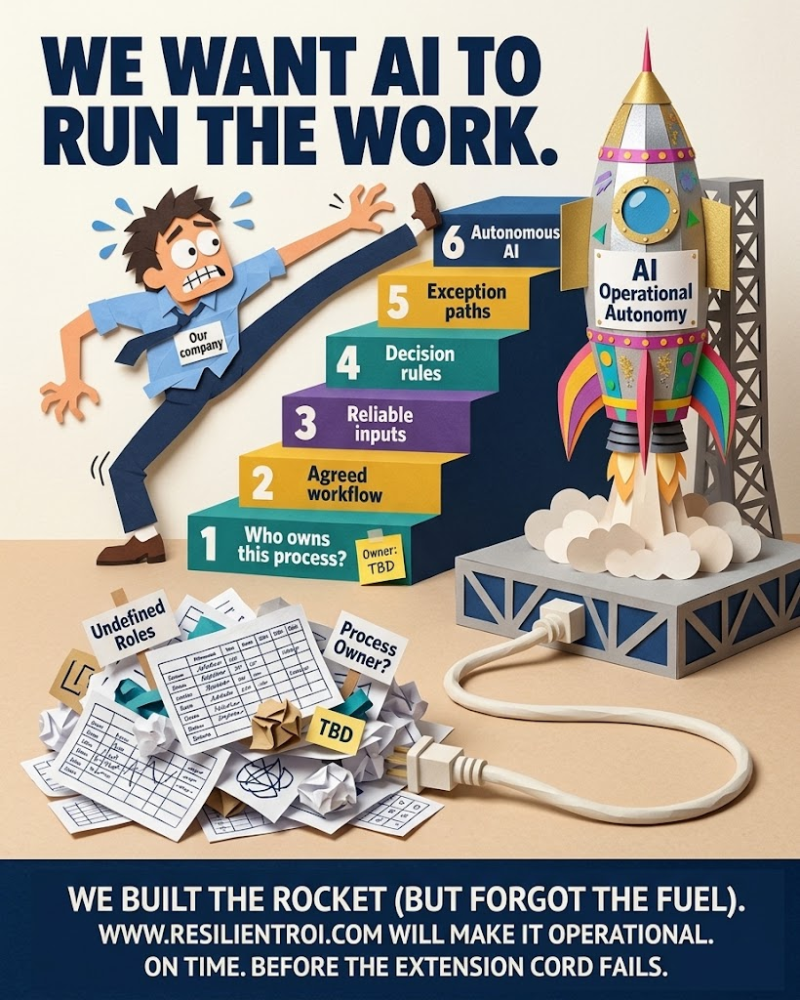

Buying the car is the easy part. Anyone can procure a BPT platform, an AI subscription, a roadmap deck with "agentic" on every third slide. Driving it without putting it in the wall on lap one is the part nobody budgets time for.

## Who Owns the Racing AI?

A fast engine with no named driver is a liability sitting in the garage, not an asset on the track. If "Owner: TBD" is still stuck to the car when someone turns the key, the manual's first chapter was never opened. Process ownership isn't a detail to backfill once the pilot is already running — it's the precondition for everything after it, per the [BPT Operating Model](https://method.dbj.org/bpt/bpt_operating_model/).

## An Automated Chef Still Needs a Recipe

Automation doesn't remove the need for a recipe — it raises the price of not having one. Feed an automated kitchen a wall of unlabelled boxes marked "Unstructured Data" and what comes out is not food, it's expensive smoke. The question to ask before the pilot isn't "can the model do this," it's "do we have a recipe it can follow." If the answer is a shrug, that's the manual telling you to stop reading past this page.

## We Want AI to Run the Work

Every pilot starts here: "we want AI to run the work." Fine — but autonomous AI is the roof, not the foundation. It sits on standard workflows, data quality, and process ownership, in that order. Pull one block out from under it because it looked like the slow part, and the roof doesn't float on good intentions. It comes down on whoever's standing closest.

## But How Will We Run the 'Engine'?

This is what driving without the manual looks like at speed: a capable engine dropped onto terrain nobody surveyed, next to two signs reading "No Process Map" and "Unvalidated Inputs." The car isn't the problem. It was never the problem. The track conditions nobody checked before hitting the throttle are the problem, and by the time you see the signs you're already on the gravel.

## We Built the Rocket (But Forgot the Fuel)

The manual's table of contents, in order: who owns this process, agreed workflow, reliable inputs, decision rules, exception paths, *then* autonomous AI. Step six is a rocket. Steps one through five are the fuel. Skip to the top of the stairs and you get exactly this picture — a beautifully built rocket, plugged into an extension cord, standing next to a pile of undefined roles and a process owner still marked TBD.

## RTFM

None of this is bureaucracy for its own sake. It's the difference between arriving at AI speed and finding out, the hard way, what's waiting at the end of a track you never read the map for. Read the [BPT Operating Model](https://method.dbj.org/bpt/bpt_operating_model/) before the next AI pilot — not after it stalls.
